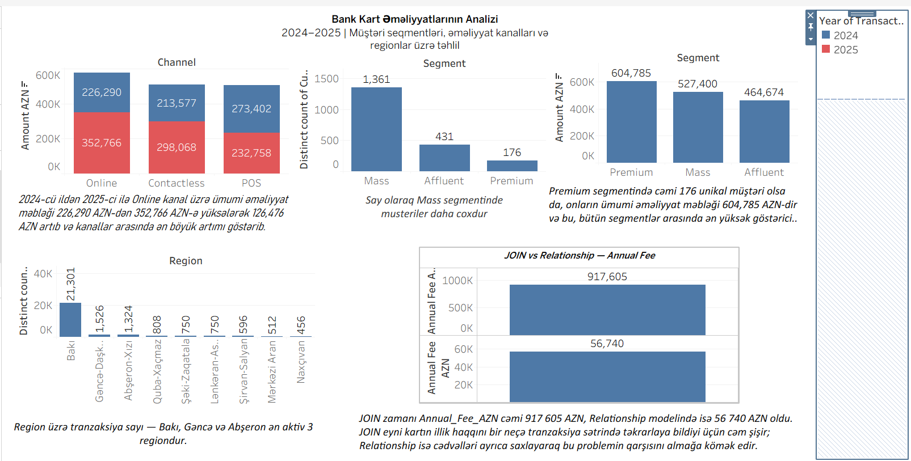

# Bank Card Transactions Analysis (2024–2025)

## Project Overview
This project analyzes bank card transactions from 2024 to 2025 using Tableau Public.

## Objectives
- Analyze transaction amounts by payment channel.
- Compare customer segments by transaction amount and customer count.
- Explore transaction activity across regions.
- Examine annual fees and data relationships.

## Tools
- Tableau Public
- Data Visualization
- Dashboard Design

## Key Insights
- Online, Contactless, and POS channels show different transaction amount patterns across 2024 and 2025.
- The Mass segment has the highest distinct customer count among the displayed customer segments.
- Baku has the highest transaction activity among the displayed regions.

## Dashboard Preview

## Files
- `Bank Card Transactions Analysis 2024–2025.twbx` — Tableau workbook.

## Author
AysInsights
